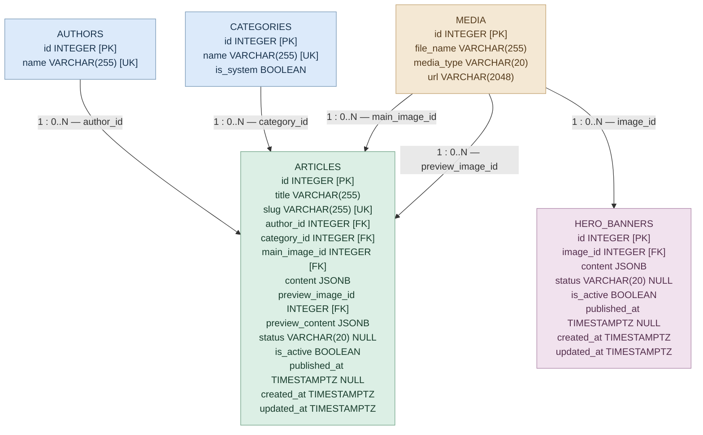

# Database schema — PostgreSQL

Five tables. The color palette visually groups entities; it has no database semantics. `PK` = Primary Key, `FK` = Foreign Key, `UK` = unique logical constraint/index.

## Meaning of relationships

| Relationship | Cardinality | Business meaning |
| --- | --- | --- |
| Authors → Articles | 1 : 0..N | One author may have zero or many articles; each article must have exactly one author. |
| Categories → Articles | 1 : 0..N | One category may contain zero or many articles; each article must have exactly one category. |
| Media → Articles (main_image_id) | 1 : 0..N | Media may be the main image for many articles; each article must have one main image. |
| Media → Articles (preview_image_id) | 1 : 0..N | Media may be used in many previews; each article must have one preview image. |
| Media → HeroBanners (image_id) | 1 : 0..N | Media may appear in many banners; each banner must have one image. |

## Constraints and backend rules

- Author and category normalized names are unique (`lower(btrim(name))`) using expression indexes.
- Article slugs are globally unique, including for inactive articles.
- System records `Unknown` have ID `-1`; application must protect against modification/deletion.
- Article preview is saved in the same row as article, not a separate table.
- Media binary files are external; only metadata and URL are stored in PostgreSQL.
- `content` and `preview_content` are nonempty JSON arrays; Plate node validation belongs in backend.
- Partial unique index enforces at most one active published banner.
- Soft deletion is represented by `is_active` rather than deleting database rows.
- Direct media foreign keys prevent deletion while referenced. References embedded in Plate JSON require additional backend checks.

## Publication lifecycle (articles and hero banners)

| is_active | status | published_at | Meaning |
|---|---|---|---|
| TRUE | draft | NULL | Active draft, hidden publicly |
| TRUE | published | timestamp | Active published, public |
| FALSE | NULL | NULL | Inactive, hidden publicly |

`published_at` records first publication in the current activation cycle. Publishing updates to an already active published item does not change it; deactivation clears both `status` and `published_at`. Restoration makes an active draft. Publishing a different hero banner deactivates the previous one atomically.

## Confirmed implementation decisions

- Database provider: **Netlify Database** (managed PostgreSQL); frontend hosting: Netlify. Node.js execution model is still to be chosen.
- New empty database; create-table scripts are not migrations of existing populated tables.
- Backend protects Unknown author/category records and maintains `updated_at`; no database triggers for these rules.
- `UNIQUE(slug)` is case-sensitive and global.
- Publication history is not preserved after deactivation.
- Media `url` is `VARCHAR(2048)`, and OpenAPI matches via `maxLength: 2048`.
- Media references inside Plate JSON require backend validation.
- Keep SQL under `src/docs/sql` for documentation; deploy Netlify Database schema through committed migrations as described in `netlify-database.md`.
