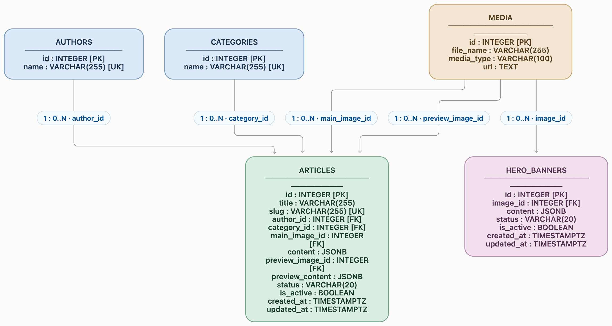

## Database Schema

PostgreSQL database consists of five tables. Article previews are stored in the `articles` table, not in a separate table. The diagram shows primary keys (`PK`), foreign keys (`FK`), uniqueness (`UK`), and relationship cardinalities.

**Legend:** `PK` = Primary Key; `FK` = Foreign Key; `UK` = Unique Key / uniqueness rule. `1 : 0..N` means that one record on the parent side may be associated with zero or more records on the child side.

## Meaning of relationships

| Relationship                        | Cardinality | Business meaning                                                                             |
| ----------------------------------- | ----------- | -------------------------------------------------------------------------------------------- |
| Authors → Articles                  | 1 : 0..N    | One author may have zero or many articles; each article must have exactly one author.        |
| Categories → Articles               | 1 : 0..N    | One category may contain zero or many articles; each article must have exactly one category. |
| Media → Articles (main_image_id)    | 1 : 0..N    | Media may be the main image for many articles; each article must have one main image.        |
| Media → Articles (preview_image_id) | 1 : 0..N    | Media may be used in many previews; each article must have one preview image.                |
| Media → HeroBanners (image_id)      | 1 : 0..N    | Media may appear in many banners; each banner must have one image.                           |

## Constraints and backend rules

- Author and category normalized names are unique (`lower(btrim(name))`) using expression indexes.
- Article slugs are globally unique, including for inactive articles.
- System records `Unknown` have ID `-1`; application must protect against modification/deletion.
- Article preview is saved in the same row as article, not a separate table.
- Media binary files are external; only metadata and URL are stored in PostgreSQL.
- `content` and `preview_content` are nonempty JSON arrays; Plate node validation belongs in backend.
- Partial unique index enforces at most one active published banner.
- Soft deletion is represented by `is_active` rather than deleting database rows.
- Direct media foreign keys prevent deletion while referenced. References embedded in Plate JSON require additional backend checks.

## To review

- Add `published_at` to preserve the true publication date for newest-published sorting.
- Confirm `updated_at` update mechanism (currently backend responsibility).
- Confirm media-reference checks and guard against modifying `Unknown` rows via direct SQL.
